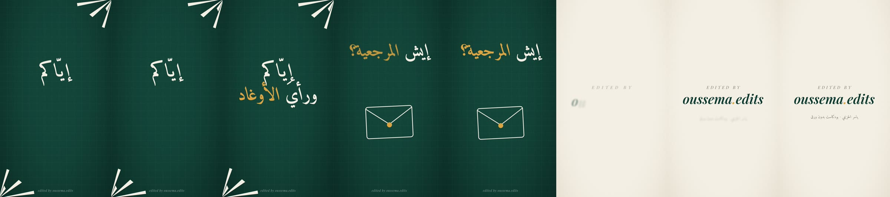
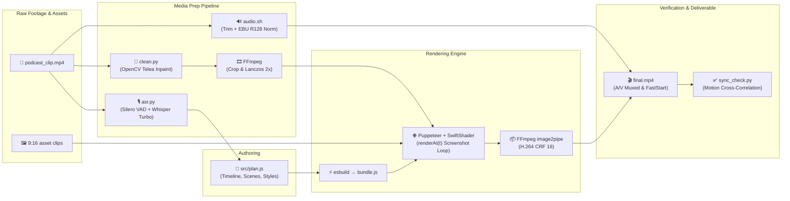

<div align="center">

# 🎬 Podcast Reel Motion

**Automated, code-driven engine that transforms podcast clips into high-retention 9:16 vertical reels (1080×1920) for Instagram Reels, TikTok, and YouTube Shorts.**

Powered by **Three.js** custom GLSL shaders, **Framer Motion** kinetic typography, **Headless Chrome** frame-by-frame rendering, and **Whisper Turbo + OpenCV** automated media prep.

[](LICENSE)
[](https://nodejs.org/)
[](https://www.python.org/)
[](https://threejs.org/)
[](https://www.framer.com/motion/)
[](https://pptr.dev/)
[](https://ffmpeg.org/)

<br/>



<br/>

> **Signature Aesthetic:** Deep emerald green (`#0E3B31`), textured cream paper (`#F4EFE4`), and antique gold accents (`#D9A441`). Elegant Amiri typography with per-word blur-rise entrance, smooth whip transitions on cuts, flat minimalist SVGs, and automated audio-video zero-drift sync.

</div>

---

## 📑 Table of Contents

- [Why Podcast Reel Motion?](#-why-podcast-reel-motion)
- [System Architecture](#-system-architecture)
- [Key Features](#-key-features)
- [Scene Modes & Shader Engine](#-scene-modes--shader-engine)
- [Prerequisites](#-prerequisites)
- [Quick Start](#-quick-start)
- [Writing a Plan (`plan.js`)](#-writing-a-plan-planjs)
- [Full Pipeline Walkthrough](#-full-pipeline-walkthrough)
- [AI Agent Skill (`SKILL.md`)](#-ai-agent-skill-skillmd)
- [Repository Structure](#-repository-structure)
- [Performance & Splicing](#-performance--splicing)
- [License & Credits](#-license--credits)

---

## 💡 Why Podcast Reel Motion?

Traditional video editors (After Effects, Premiere, CapCut) require tedious manual keyframing, prone to caption misalignment, heavy rendering overhead, and difficult version control.

**Podcast Reel Motion** replaces manual editing with **pure code and deterministic rendering**:

1. **Zero-Drift Synchronization:** Instead of relying on real-time screen capture, the reel operates on an immutable clock $t = n / 30$. Headless Chrome evaluates each exact timestamp $t$ and screenshots the render target. Audio and video can never drift.
2. **AI-Assisted Preprocessing:** Automatically inpaint burned-in captions with OpenCV, align dialectal speech with Whisper Turbo & Silero VAD, and normalize audio to social platform standards (−14 LUFS).
3. **Reproducible & Programmable:** The entire video is defined in a concise JavaScript plan file (`src/plan.js`) that can be generated, previewed, and modified in seconds.

---

## 🏗 System Architecture



---

## ✨ Key Features

| Capability | Description |
|---|---|
| **Deterministic Frame Rendering** | `renderAt(t)` seeks every WebGL shader uniform and Framer Motion controller to exact time $t = n / 30$. Rendering frame 450 produces the exact same image whether rendered standalone or sequentially. |
| **Unified GLSL Shader** | A single full-screen WebGL quad handles paper grain, emerald backgrounds, camera footage cards with rounded-corner signed distance functions (SDF), dynamic vignettes, and 9:16 vertical b-roll footage. |
| **Kinetic Arabic Subtitles** | RTL support for Amiri font. Words animate individually with gaussian blur decay, rise upward, and fade in, with targeted gold accent highlights (`*كلمة`). |
| **Intelligent Caption Inpainting** | `scripts/clean.py` isolates bright white burned-in subtitles via luminance masks and reconstructs the underlying pixels using OpenCV's Telea inpainting algorithm. |
| **Dialect-Tuned ASR** | `scripts/asr.py` pairs Silero Voice Activity Detection with Whisper Turbo (via sherpa-onnx CPU int8), optimized for rapid speech and dialectal Arabic (Levantine, Gulf, etc.). |
| **Studio Audio Mastering** | `scripts/audio.sh` executes 70 Hz high-pass filtering, pads silence for the animated end card, and normalizes integrated loudness to **−14 LUFS / −1.5 dBTP** (EBU R128). |
| **Mathematical Sync Proof** | `scripts/sync_check.py` computes temporal cross-correlation of visual motion gradients between the rendered reel and original clip to guarantee 0-frame offset. |
| **Partial Re-rendering** | Edit just one sentence? Render only frames $A \dots B$ in seconds and splice them into the master video without re-encoding everything. |

---

## 🎨 Scene Modes & Shader Engine

The background and footage presentation are governed by an orthographic fragment shader using 6 scene modes:

| Mode | Scene Type | Shader & Compositing Details |
|:---:|---|---|
| `0` | **Cream Paper** | Light cream background (`#F4EFE4`), radial vignette, subtle 72px procedural grid at 55% opacity, and per-pixel film grain. |
| `1` | **Emerald Green** | Deep forest green (`#0E3B31`), radial lighting, fine gridlines, gold/white typography, and ambient dust grain. |
| `2` | **Full-Bleed Footage** | Speaker footage fills the vertical 1080×1920 canvas with soft top & bottom dark-green gradient fades for high subtitle legibility. |
| `3` | **Card on Cream** | Speaker footage enclosed in a rounded rectangle (34px radius SDF) with soft drop shadow and 1px edge rim on cream background. |
| `4` | **Card on Green** | Speaker footage card floating over the signature deep emerald green backdrop. |
| `5` | **9:16 Asset / B-Roll** | Full-screen vertical asset clip with smooth continuous micro-zoom and layered typography above and below the subject. |

---

## 📦 Prerequisites

Ensure your system has the following tools installed:

- **Node.js** $\ge 18.0.0$ and **npm**
- **Python** $\ge 3.10$ with `pip`
- **FFmpeg** & **ffprobe** installed and accessible in your system `PATH`
- **Google Chrome** or **Chromium** (used by Puppeteer for headless rendering)
  - *Linux default path:* `/usr/bin/google-chrome`
  - *macOS / Windows:* Update `executablePath` in `render.js` or ensure Chrome is detected automatically.

---

## 🚀 Quick Start

### 1. Installation

Clone this repository and run the setup script:

```bash
git clone https://github.com/OussEmabouchahwa/podcast-reel-motion.git
cd podcast-reel-motion

# Install dependencies and download ASR models & fonts
npm run setup
```

The setup script automatically:
- Installs Node dependencies (`three`, `framer-motion`, `puppeteer-core`, `esbuild`)
- Downloads Google Amiri font families (`Amiri-Italic.ttf`, `Amiri-BoldItalic.ttf`) to `public/`
- Downloads sherpa-onnx Whisper Turbo & Silero VAD weights
- Initializes `src/plan.js` from `src/plan.example.js`

### 2. Five-Step Production Flow

```bash
# Step 1: Remove burned-in captions & extract frames (Lanczos 2x upscale)
python3 scripts/clean.py raw_clip.mp4 clean.mp4 200 470 240 380
ffmpeg -i clean.mp4 -vf "crop=W:H:X:Y,scale=2*W:2*H:flags=lanczos" -q:v 2 public/frames/%04d.jpg

# Step 2: Generate timestamped speech transcript
ffmpeg -i raw_clip.mp4 -vn -ac 1 -ar 16000 audio.wav
python3 scripts/asr.py audio.wav

# Step 3: Author your timeline in src/plan.js and preview keyframes
npm run preview -- 1.5,4.0,12.5,28.0        # Generates out/pv_<timestamp>.jpg

# Step 4: Render video, process audio, and mux final reel
npm run render -- 0                         # Generates out/part_0000.mp4
bash scripts/audio.sh raw_clip.mp4 58.2 out/voice.wav
ffmpeg -i out/part_0000.mp4 -i out/voice.wav -map 0:v -map 1:a \
       -c:v libx264 -crf 20 -pix_fmt yuv420p -c:a aac -b:a 192k \
       -movflags +faststart -shortest out/final.mp4

# Step 5: Verify A/V sync (verifies 0-frame offset)
python3 scripts/sync_check.py out/final.mp4 clean.mp4 0 "90,790,900,560" "18,234,540,336" 3.0 4.2
```

---

## ✍️ Writing a Plan (`plan.js`)

Video timelines are written as intuitive, declarative JavaScript in `src/plan.js`:

```javascript
import { C, CFG, scene, line, ph, rays, icon, endCard, start } from './engine.js';

// Global Project Configuration
Object.assign(CFG, {
  NFR: 1746,                 // Total frame count
  SRC_FPS: 30,               // Source footage framerate
  SRC_ASP: 1152 / 724,       // Aspect ratio of extracted frames
  OFFSET: 0,                 // Source sync offset in seconds
  END0: 58.2,                // Voice cutoff timestamp before end card
  handle: 'oussema.edits',   // Creator signature
  credit: 'Speaker Name · Podcast Title'
});

// Scene 1: Green Opener with Corner Rays and Title
{
  const sc = scene(0, 2.72, 1);
  rays(sc);
  line(sc, ph('عنوان *الحلقة', 1.44, 2.4), 930, 150, 'b', C.cream, C.gold);
}

// Scene 2: Speaker Footage in Rounded Card on Cream Paper
{
  const sc = scene(2.72, 7.5, 3, {
    card: [60, 760, 960, 604], // [x, y, width, height]
    zoom: [1.0, 1.05]          // Dynamic subtle push-in
  });
  line(sc, [['فكرة', 5.35], ['*رائعة', 6.33]], 610, 150, 'b', C.ink, C.green);
}

// Scene 3: B-Roll 9:16 Asset Overlay
{
  const sc = scene(50.98, 53.68, 5, {
    asset: 'handshake',
    assetFrames: 90
  });
}

// Animated Outro Card & Engine Initialization
endCard();
start();
```

### Key API Helpers

- `scene(startSec, endSec, mode, opts)`: Defines a scene block.
- `line(scene, words, y, size, weight, baseColor, accentColor, tOut)`: Renders RTL Arabic words. Prepending `*` to any word switches it to `accentColor`.
- `ph(sentence, startSec, endSec)`: Automatically balances word timings across a speech duration based on character count.
- `rays(scene)`: Adds animated corner ray decorations.
- `icon(scene, svgPath, x, y, size, inSec, outSec)`: Positions and animates clean vector iconography.
- `endCard()`: Builds the branded animated outro with creator social handles and credits.

---

## 🤖 AI Agent Skill (`SKILL.md`)

This repository is fully packaged with a Claude / Antigravity Agent Skill specification: [`SKILL.md`](SKILL.md).

When working with an AI coding agent:
- Load `SKILL.md` into the agent's context.
- Provide a clip URL or file and prompt: *"Turn this clip into a reel in the oussema.edits style"*.
- The agent reads `SKILL.md` rules (strict color palette, Islamic aesthetic constraints, Telea inpainting, exact Quran/Hadith verification, ASR segmentation) and writes `src/plan.js`, previews frames, renders, and verifies sync autonomously.

---

## 📂 Repository Structure

```
podcast-reel-motion/
├── .gitignore               # Ignored cache, frames, weights, output artifacts
├── LICENSE                  # MIT License
├── README.md                # Project documentation & guides
├── SKILL.md                 # Agent skill instructions & editing rules
├── package.json             # NPM dependencies & operational scripts
├── render.js                # Puppeteer frame server & FFmpeg image2pipe render loop
├── docs/
│   ├── ARCHITECTURE.md      # In-depth architectural & math documentation
│   └── preview.jpg          # Reel sample screenshots
├── public/
│   └── index.html           # Composited DOM stack (WebGL Canvas, Deco, Text, Footer)
├── src/
│   ├── engine.js            # Three.js GLSL shaders, Framer Motion controller & helpers
│   └── plan.example.js      # Reference timeline plan
└── scripts/
    ├── setup.sh             # Dependency installer, font downloader & ASR setup
    ├── clean.py             # OpenCV Telea burned-in subtitle inpainting
    ├── asr.py               # Sherpa-onnx Whisper Turbo + Silero VAD transcriber
    ├── audio.sh             # Voice track trim, silence pad & EBU R128 normalizer
    └── sync_check.py        # Video/audio motion cross-correlation sync validator
```

---

## ⚡ Performance & Splicing

- **Rendering Speed:** On a modest 2-core CPU without a dedicated GPU, headless Chrome with SwiftShader renders at $\approx 3 \text{ fps}$ (a 60-second reel renders in $\approx 10 \text{ minutes}$).
- **Partial Splicing:** If you tweak text in scene 3 (frames 600 to 750), don't re-render the whole video! Run:

```bash
# Render only changed frame window:
node render.js full 600 750                  # Generates out/part_0600.mp4

# Splice seamlessly with ffmpeg concat without frame drops:
ffmpeg -i out/part_0000.mp4 -i out/part_0600.mp4 -filter_complex \
  "[0:v]trim=0:20,setpts=PTS-STARTPTS[v1]; \
   [1:v]trim=0:5,setpts=PTS-STARTPTS[v2]; \
   [0:v]trim=25:58,setpts=PTS-STARTPTS[v3]; \
   [v1][v2][v3]concat=n=3:v=1:a=0[outv]" -map "[outv]" out/spliced.mp4
```

---

## 📄 License & Credits

Developed with ❤️ by **[Oussema Bouchahwa](https://github.com/OussEmabouchahwa)** (`oussema.edits`).

Distributed under the **MIT License**. See [`LICENSE`](LICENSE) for details.
