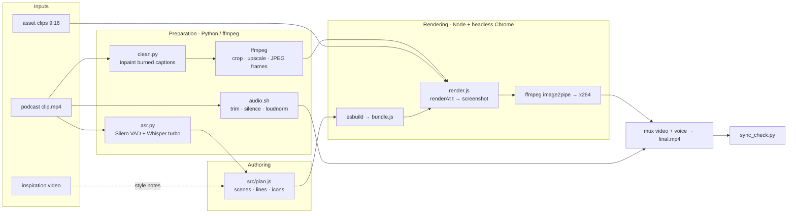
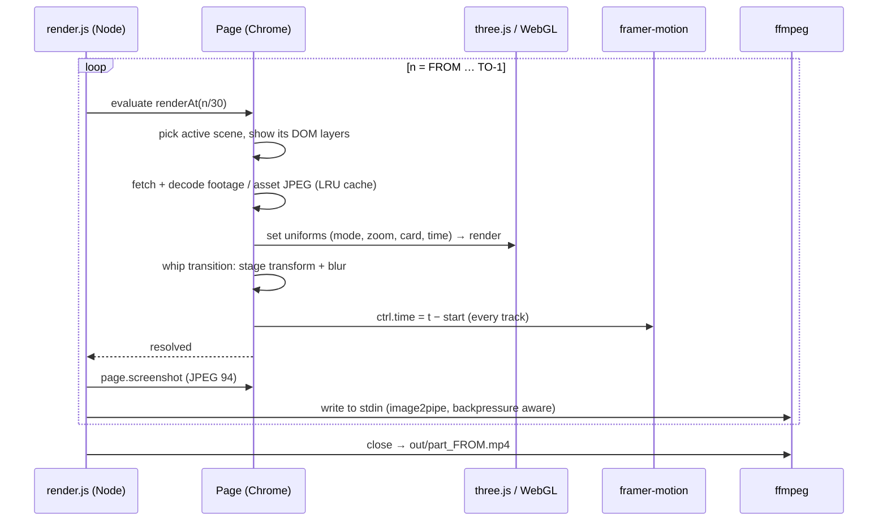

# Architecture

This document explains how a reel is produced: the end-to-end pipeline, the time model that keeps audio and picture in sync, the page's layer stack, the background shader, the animation system and the render loop.

## 1. End-to-end pipeline



Each stage writes plain files (`frames/*.jpg`, `plan.js`, `part_*.mp4`, `voice.wav`), so you can rerun any step on its own.

## 2. Time model

All synchronisation comes from one rule: **the reel has one clock, `t` in seconds, and frame `n` is rendered at exactly `t = n / 30`.**

| Quantity | Formula |
|---|---|
| reel frame → time | `t = n / 30` |
| footage source time | `s = t − OFFSET` (or `sc.src + (t − sc.a)` for a hook scene that replays a later line) |
| footage frame | `floor(s · SRC_FPS)` → `frames/NNNN.jpg` |
| asset frame | `floor((t − sc.a) · 30)` → `assets/<name>/NNNN.jpg` |
| text / icon state | every framer-motion control gets `ctrl.time = t − start` |
| voice track | the source audio, placed so that source second 0 sits at reel second `OFFSET` |

Nothing depends on wall-clock time, `requestAnimationFrame`, or how long a frame takes to render. Rendering frame 900 alone gives exactly the same image as rendering frames 0 through 900. Partial re-renders work for that reason.



## 3. Page layer stack (`public/index.html`)

```
┌──────────────── #stage (transform + blur during transitions) ────────────────┐
│  canvas#bg      three.js · background, footage, card, asset, grain           │
│  div#deco       rays, flat icons (per-scene containers)                      │
│  div#text       Arabic lines (per-scene containers)                          │
└──────────────────────────────────────────────────────────────────────────────┘
   div#foot       "edited by oussema.edits" (outside the stage: never blurred)
```

Each `scene()` creates one container in `#deco` and one in `#text`. `renderAt` shows only the active scene's two containers, so a scene's DOM can never bleed into the next scene.

## 4. Background shader

A single orthographic full-screen quad uses one `ShaderMaterial`. `uMode` selects the look:

| uMode | Branch | Notes |
|---|---|---|
| 0 | cream paper | radial vignette + 72 px grid at 55 % |
| 1 | deep green | radial vignette + lighter 72 px grid |
| 2 | full-bleed footage | cover-fit with `uZoom` / `uC` (face centre), vignette, dark-green fade at top and bottom for captions |
| 3 / 4 | card on cream / green | rounded-box SDF (`rbox`, r = 34 px), soft drop shadow, 1 px light rim; the footage is cover-fitted inside the card rectangle `uCard` |
| 5 | asset | 9:16 texture sampled straight through, slow zoom |

Every mode then gets per-frame film grain: `hash(pixel + t)` gives ±1.5 % on paper and ±2.5 % on footage.

**Textures.** In WebGL2, three.js allocates immutable texture storage, so one `THREE.Texture` cannot change size after its first upload. The engine therefore keeps one texture for footage and one per asset name, and swaps `uTex` between them. Uploading an asset frame into the footage texture would silently keep showing the footage.

**Cover-fit maths** (`foot()` in the shader): for a target rectangle with aspect `asp` and a source of aspect `uSrcAsp`, the sampled window is `hf = 1/zoom`, `wf = asp / uSrcAsp / zoom`. Its centre is clamped so the window never leaves the frame. This lets one set of frames feed a full-bleed scene, a wide card and a tall card.

## 5. Animation system

framer-motion's `animate(node, keyframes, {duration, times, ease})` returns a controller. The engine **pauses it immediately** and treats it as a pure function of time:

```js
track(node, start, [[0, hid], [0.32, vis], [end - 0.12, vis], [end, out]], ['easeOut', 'linear', 'easeIn']);
// in renderAt:   ctrl.time = clamp(t - start, 0, T)
```

- **Words** (`line`): each word is its own `inline-block` with its own `track`. It comes in over 0.32 s (blur 14 → 0 px, y +26 → 0, opacity 0 → 1) and goes out over 0.12 s. `ph()` spreads entry times across a spoken phrase by character count (85 % of the span), so longer words get more time.
- **Rays, icons, end card**: all use the same `track` primitive with `backOut` for pops.
- **Transforms**: framer-motion writes `transform` itself. Any element positioned with `translate(-50%,-50%)` (the `ctr()` helper) is therefore wrapped, and the animated node is its child. Animating the centred node directly makes it jump off-centre.

## 6. Transitions

Transitions are not separate clips. They are computed from the active scene in `renderAt`:

```
first 0.20 s of a scene:  stage  y = 90·k,      blur = 22·k px,  scale = 1 + 0.11·k   (k: 1 → 0, ease-out cubic)
last  0.14 s of a scene:  stage  y = −80·k²,    blur = 20·k² px, scale = 1 + 0.10·k²  (k: 0 → 1)
footage scenes also get a zoom "kick": uZoom × (1 + 0.06·(1 − ease(tl/0.35)))
```

The outgoing scene accelerates up and blurs, and the incoming one decelerates in from below. Because both sides are blurred at the cut, the cut itself is invisible.

## 7. Render loop and encoding

`render.js` serves `public/` over HTTP. Module scripts need the correct MIME type, so they cannot load from `file://`. It launches Chrome with SwiftShader WebGL, so no GPU is needed, then either:

- `preview t1,t2,…` writes `out/pv_<t>.jpg` for visual review, or
- `full FROM TO` pipes JPEG screenshots into `ffmpeg -f image2pipe -c:v mjpeg` → x264 CRF 16, respecting stdin back-pressure.

The final mux re-encodes to CRF 20, yuv420p, `+faststart`, AAC 192 k. Splicing partial renders is a `trim=start_frame/end_frame` + `concat` filter on whole frames, so no frame is ever duplicated or dropped.

## 8. Audio

`scripts/audio.sh` trims the source to `END0`, adds 2.4 s of silence for the end card, applies a 70 Hz high-pass and EBU R128 loudness normalisation at −14 LUFS / −1.5 dBTP (the usual target for social platforms), and resamples to 48 kHz. Its duration equals the video duration, which `ffprobe` confirms before delivery.

For a hook that replays a later line first, the voice track is `[hook trim][silence][full clip][end silence]`, and its first two parts must add up to exactly `OFFSET`.

## 9. Verification

`scripts/sync_check.py` measures sync rather than assuming it. For each reel window that lies inside a single footage scene, it:

1. crops the footage area of the reel and the same area of the source, at 30 fps;
2. computes a **motion signal**, the mean absolute difference between consecutive frames, and normalises it;
3. cross-correlates the two signals over lags −6 … +6 frames.

Motion survives the scene's zoom, grade, grain and card framing, where a direct pixel comparison would not. In-sync output is `lag +0` with r ≈ 0.99 in every window. As a test, shifting `OFFSET` by 0.1 s makes it report a 3-frame lag. Run it after every full render or splice.

## 10. Supporting tools

| Script | Technique |
|---|---|
| `clean.py` | HSV threshold for white (V > 200, S < 60) inside a box → connected components smaller than 4000 px (glyphs, not white clothing) → dilate → `cv2.inpaint` Telea, r = 6 |
| `asr.py` | Silero VAD splits speech (tunable min-silence / max-speech) → each segment decoded by Whisper turbo int8 with `language=ar` → `start - end text` lines |
| `audio.sh` | ffmpeg filter graph: atrim · afade · anullsrc · concat · highpass · loudnorm |
| `sync_check.py` | motion signal (frame-difference energy) of reel vs source → cross-correlation over ±6 frames |

## 11. Design constraints (from the editor)

- Palette is fixed: green `#0E3B31`, cream `#F4EFE4`, gold `#D9A441`, ink `#151515`, gray `#7B776E`. Inspiration videos inform the editing only, never the colours.
- No 3D models and no large translucent background words: metaphors are simple flat icons.
- No depictions of prophets, companions or Ahl al-Bayt.
- Every reel carries `edited by oussema.edits` and an end card.
